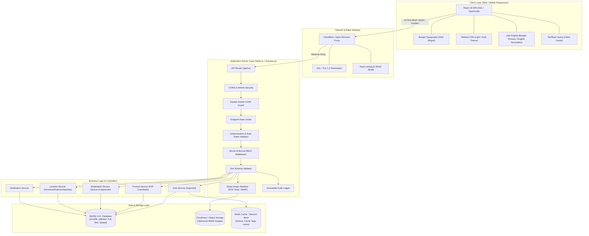

# Phase 1: Project Architecture and Technical Planning
## Bangladesh Used Products Marketplace (BikroyBD — কেনাবেচা)
**Specification Version:** 1.0.0  
**Status:** Approved Architecture Blueprint  
**Authors:** Senior Full-Stack Software Architect, Database Architect & Application Security Engineer  

---

## 1. Complete Project Folder Structure

The project is structured as a modular monorepo cleanly decoupling the frontend (`client/`), backend (`server/`), database migrations and seeds (`database/`), shared contracts (`shared/`), and automated test suites (`tests/`).

```
bikroybd/
├── .env.example                                  # Master environment variable template
├── .gitignore                                    # Git ignore rules for node_modules, build outputs, secrets
├── docker-compose.yml                            # Local development stack (MySQL 8.0 + Redis + Adminer)
├── package.json                                  # Monorepo root scripts & workspace configuration
├── README.md                                     # Project onboarding and developer manual
│
├── client/                                       # Frontend Application (React 18 + TypeScript + Vite)
│   ├── index.html                                # HTML entry point with Hind Siliguri font preloads
│   ├── package.json                              # Frontend dependencies & scripts
│   ├── tsconfig.json                             # Strict TypeScript compiler options
│   ├── vite.config.ts                            # Vite build config with path aliases & API proxy
│   ├── tailwind.config.js                        # Tailwind CSS design system with custom colors & fonts
│   ├── postcss.config.js
│   ├── public/
│   │   ├── favicon.ico
│   │   ├── robots.txt
│   │   └── placeholder-image.webp
│   └── src/
│       ├── main.tsx                              # React DOM mount point
│       ├── App.tsx                               # Router, Context Providers (Auth, Theme, i18n)
│       ├── assets/
│       │   ├── fonts/                            # Hind Siliguri font assets
│       │   └── icons/                            # SVG iconography (Bangla flag, BDT glyph, etc.)
│       ├── components/
│       │   ├── common/                           # Generic UI atoms & molecules
│       │   │   ├── Button.tsx
│       │   │   ├── Input.tsx
│       │   │   ├── Textarea.tsx
│       │   │   ├── Modal.tsx
│       │   │   ├── Badge.tsx
│       │   │   ├── Dropdown.tsx
│       │   │   ├── SkeletonLoader.tsx
│       │   │   ├── EmptyState.tsx
│       │   │   └── ConfirmationDialog.tsx
│       │   ├── layout/                           # Shell components
│       │   │   ├── Navbar.tsx
│       │   │   ├── MobileBottomNav.tsx
│       │   │   ├── Footer.tsx
│       │   │   ├── Sidebar.tsx
│       │   │   ├── ThemeToggle.tsx               # Light/Dark mode switcher
│       │   │   └── LanguageSwitcher.tsx          # বাংলা / English toggle
│       │   ├── product/                          # Marketplace product components
│       │   │   ├── ProductCard.tsx
│       │   │   ├── ProductGrid.tsx
│       │   │   ├── ProductFilterSidebar.tsx
│       │   │   ├── ImageGallery.tsx
│       │   │   ├── ConditionBadge.tsx            # Like New, Good, Fair, For Parts
│       │   │   └── SellerContactModal.tsx        # Click-to-reveal phone & WhatsApp
│       │   ├── location/                         # Bangladesh geography selectors
│       │   │   ├── LocationSelectorModal.tsx
│       │   │   └── DivisionDistrictPicker.tsx
│       │   └── admin/                            # Back-office components
│       │       ├── AdminHeader.tsx
│       │       ├── ModerationCard.tsx
│       │       ├── ReportActionModal.tsx
│       │       └── AuditLogTable.tsx
│       ├── context/
│       │   ├── AuthContext.tsx                   # Session, current user, role helpers
│       │   ├── ThemeContext.tsx                  # Light / Dark theme persistence
│       │   └── LanguageContext.tsx               # i18n translation provider
│       ├── hooks/
│       │   ├── useAuth.ts
│       │   ├── useProducts.ts                    # TanStack Query hook with caching
│       │   ├── useDebounce.ts                    # For search input throttling
│       │   └── useMediaQuery.ts
│       ├── i18n/
│       │   ├── bn.json                           # Bangla language dictionary
│       │   └── en.json                           # English language dictionary
│       ├── pages/
│       │   ├── HomePage.tsx                      # Hero search, top categories, featured ads
│       │   ├── ProductListingPage.tsx            # Filterable marketplace grid
│       │   ├── ProductDetailPage.tsx             # Full specs, photo carousel, seller contact
│       │   ├── PostAdPage.tsx                    # Multi-step ad creation wizard
│       │   ├── SellerDashboardPage.tsx           # My ads, active/sold toggles, stats
│       │   ├── WishlistPage.tsx                  # Saved favorite products
│       │   ├── auth/
│       │   │   ├── LoginPage.tsx
│       │   │   ├── RegisterPage.tsx
│       │   │   └── ForgotPasswordPage.tsx
│       │   └── admin/
│       │       ├── AdminDashboardPage.tsx
│       │       ├── ModerationQueuePage.tsx       # Pending ad approval/rejection
│       │       ├── ReportManagementPage.tsx      # User/ad abuse reports
│       │       ├── UserManagementPage.tsx        # Account suspensions & roles
│       │       └── CategoryManagerPage.tsx
│       ├── services/
│       │   ├── api.ts                            # Axios instance with CSRF & JWT interceptors
│       │   ├── authService.ts
│       │   ├── productService.ts
│       │   ├── locationService.ts
│       │   ├── moderationService.ts
│       │   └── adminService.ts
│       └── utils/
│           ├── formatters.ts                     # BDT currency (৳), Bengali numeral converter
│           ├── dateUtils.ts                      # Asia/Dhaka relative time formatting
│           └── validators.ts                     # Zod client schemas
│
├── server/                                       # Backend Application (Node.js + Express.js + TS)
│   ├── package.json                              # Backend dependencies & scripts
│   ├── tsconfig.json                             # Backend TypeScript configuration
│   └── src/
│       ├── index.ts                              # HTTP server bootstrap & graceful shutdown
│       ├── app.ts                                # Express app setup, middleware mounting, routing
│       ├── config/
│       │   ├── env.ts                            # Validated environment variables (Zod)
│       │   ├── database.ts                       # MySQL 8.0 connection pool (mysql2/promise)
│       │   ├── redis.ts                          # Redis client (optional caching/rate-limiting)
│       │   └── storage.ts                        # Cloudinary / S3 configuration
│       ├── constants/
│       │   ├── errorCodes.ts
│       │   ├── permissions.ts
│       │   └── roles.ts
│       ├── controllers/
│       │   ├── auth.controller.ts
│       │   ├── product.controller.ts
│       │   ├── category.controller.ts
│       │   ├── location.controller.ts
│       │   ├── wishlist.controller.ts
│       │   ├── report.controller.ts
│       │   ├── moderation.controller.ts
│       │   └── admin.controller.ts
│       ├── middleware/
│       │   ├── authenticate.ts                   # JWT bearer & cookie session validator
│       │   ├── authorize.ts                      # RBAC role & permission checker
│       │   ├── validate.ts                       # Zod request payload validator
│       │   ├── rateLimiter.ts                    # IP & user-level rate limiting
│       │   ├── upload.ts                         # Multer memory storage & magic byte validator
│       │   ├── csrf.ts                           # Double submit CSRF verification
│       │   ├── auditLogger.ts                    # Interceptor for administrative mutations
│       │   └── errorHandler.ts                   # Centralized error formatter
│       ├── models/                               # Data access layer (Parameterized MySQL queries)
│       │   ├── user.model.ts
│       │   ├── session.model.ts
│       │   ├── product.model.ts
│       │   ├── category.model.ts
│       │   ├── location.model.ts
│       │   ├── wishlist.model.ts
│       │   ├── report.model.ts
│       │   ├── notification.model.ts
│       │   ├── audit.model.ts
│       │   └── setting.model.ts
│       ├── routes/
│       │   ├── v1/
│       │   │   ├── index.ts                      # Aggregated v1 route index
│       │   │   ├── auth.routes.ts
│       │   │   ├── product.routes.ts
│       │   │   ├── category.routes.ts
│       │   │   ├── location.routes.ts
│       │   │   ├── wishlist.routes.ts
│       │   │   ├── report.routes.ts
│       │   │   ├── moderation.routes.ts
│       │   │   └── admin.routes.ts
│       ├── services/
│       │   ├── auth.service.ts
│       │   ├── product.service.ts
│       │   ├── media.service.ts                  # Sharp image optimization & Cloudinary upload
│       │   ├── moderation.service.ts
│       │   └── notification.service.ts
│       ├── types/
│       │   └── express.d.ts                      # Custom Request types with authenticated User
│       └── utils/
│           ├── password.ts                       # Argon2id hashing & timingSafeEqual
│           ├── jwt.ts                            # Token signing & verification
│           ├── apiResponse.ts                    # Uniform response envelope builder
│           └── logger.ts                         # Winston structured logging
│
├── database/                                     # Database Layer
│   ├── migrate.js                                # Transactional migration runner
│   ├── migrations/                               # Versioned SQL migrations (Up/Down)
│   │   ├── 001_create_roles_and_permissions.sql
│   │   ├── 002_create_users_and_sessions.sql
│   │   ├── 003_create_locations_hierarchy.sql
│   │   ├── 004_create_categories_and_subcategories.sql
│   │   ├── 005_create_products_and_images.sql
│   │   ├── 006_create_wishlists_and_contacts.sql
│   │   ├── 007_create_reports_and_moderation.sql
│   │   └── 008_create_notifications_banners_settings_audit.sql
│   └── seeds/
│       └── 001_seed_initial_data.sql             # Bangladesh divisions, districts, categories, roles
│
├── shared/                                       # Shared TypeScript code between Client & Server
│   ├── types/
│   │   ├── index.ts                              # Domain models, enums (ProductCondition, ModerationStatus)
│   │   └── api.ts                                # Request DTOs, API envelopes, Query params
│   └── schemas/                                  # Shared Zod validation schemas
│       ├── auth.schema.ts
│       └── product.schema.ts
│
├── tests/                                        # Automated Testing Suite
│   ├── unit/                                     # Pure function & utility tests
│   │   ├── password.test.ts                      # Argon2id hashing & salt verification
│   │   ├── bengaliFormatters.test.ts             # Numeral & currency conversion
│   │   └── queryBuilder.test.ts                  # Parameterized query generation
│   ├── integration/                              # API and DB integration tests
│   │   ├── auth.api.test.ts                      # Register, login, refresh, logout
│   │   ├── products.api.test.ts                  # CRUD, status transitions, search
│   │   └── moderation.api.test.ts                # Queue, approval, rejection, notifications
│   ├── security/                                 # Authorization & penetration tests
│   │   ├── rbac.test.ts                          # Privilege escalation & unauthorized access
│   │   ├── idor.test.ts                          # Modifying another seller's listing
│   │   ├── csrf.test.ts                          # State mutations without CSRF token
│   │   └── sqlInjection.test.ts                  # Malicious search payloads
│   └── e2e/                                      # End-to-end user journeys (Playwright/Cypress)
│       ├── buyerJourney.spec.ts                  # Search -> Filter -> Detail -> View Contact
│       ├── sellerJourney.spec.ts                 # Post Ad -> Moderation Wait -> Mark Sold
│       └── moderatorJourney.spec.ts              # Review Queue -> Inspect -> Approve/Reject
│
└── docs/                                         # Architecture, Data Dictionaries & Specs
    ├── ARCHITECTURE.md
    ├── DATA_DICTIONARY.md
    ├── API_SPECIFICATION.md
    ├── SECURITY_AND_ROLES.md
    └── PHASE_1_MASTER_BLUEPRINT.md
```

---

## 2. System Architecture Diagram



---

## 3. MySQL Entity-Relationship Diagram (ERD)

```mermaid
erDiagram
    ROLES ||--o{ ROLE_PERMISSIONS : contains
    PERMISSIONS ||--o{ ROLE_PERMISSIONS : assigned_to
    USERS ||--o{ USER_ROLES : has
    ROLES ||--o{ USER_ROLES : grants
    USERS ||--o{ USER_SESSIONS : maintains
    
    LOCATIONS_DIVISIONS ||--o{ LOCATIONS_DISTRICTS : includes
    LOCATIONS_DISTRICTS ||--o{ LOCATIONS_UPAZILAS : contains

    CATEGORIES ||--o{ SUBCATEGORIES : classifies

    USERS ||--o{ PRODUCTS : owns_listing
    CATEGORIES ||--o{ PRODUCTS : categorized_in
    SUBCATEGORIES ||--o{ PRODUCTS : subcategorized_in
    LOCATIONS_DIVISIONS ||--o{ PRODUCTS : located_in_division
    LOCATIONS_DISTRICTS ||--o{ PRODUCTS : located_in_district
    LOCATIONS_UPAZILAS ||--o{ PRODUCTS : located_in_upazila
    USERS ||--o{ PRODUCTS : reviewed_by_moderator

    PRODUCTS ||--o{ PRODUCT_IMAGES : displays
    USERS ||--o{ WISHLISTS : saves
    PRODUCTS ||--o{ WISHLISTS : favorited_in

    USERS ||--o{ SELLER_CONTACTS : buyer_recorded
    USERS ||--o{ SELLER_CONTACTS : seller_received
    PRODUCTS ||--o{ SELLER_CONTACTS : item_inquired

    USERS ||--o{ REPORTS : reported_by
    PRODUCTS ||--o{ REPORTS : target_product
    USERS ||--o{ REPORTS : target_user
    USERS ||--o{ REPORTS : resolved_by_staff

    USERS ||--o{ NOTIFICATIONS : receives
    USERS ||--o{ AUDIT_LOGS : initiated_by

    USERS {
        bigint id PK
        char uuid UK
        varchar full_name
        varchar email UK
        varchar phone_number UK
        varchar password_hash
        boolean is_verified
        boolean is_suspended
        int division_id FK
        int district_id FK
        datetime created_at
    }

    ROLES {
        int id PK
        varchar name UK
        varchar display_name_bn
        varchar display_name_en
    }

    PERMISSIONS {
        int id PK
        varchar code UK
        varchar module
    }

    LOCATIONS_DIVISIONS {
        int id PK
        varchar name_bn
        varchar name_en
        varchar slug UK
    }

    LOCATIONS_DISTRICTS {
        int id PK
        int division_id FK
        varchar name_bn
        varchar name_en
        varchar slug UK
    }

    LOCATIONS_UPAZILAS {
        int id PK
        int district_id FK
        varchar name_bn
        varchar name_en
        varchar slug
    }

    CATEGORIES {
        int id PK
        varchar name_bn
        varchar name_en
        varchar slug UK
        varchar icon_name
    }

    SUBCATEGORIES {
        int id PK
        int category_id FK
        varchar name_bn
        varchar name_en
        varchar slug
    }

    PRODUCTS {
        bigint id PK
        char uuid UK
        bigint seller_id FK
        varchar title
        varchar slug
        text description
        int category_id FK
        int subcategory_id FK
        decimal price_bdt
        boolean is_negotiable
        enum condition
        int division_id FK
        int district_id FK
        int upazila_id FK
        varchar contact_phone
        boolean hide_phone
        boolean allow_whatsapp
        enum moderation_status
        enum availability_status
        int views_count
        datetime created_at
    }

    PRODUCT_IMAGES {
        bigint id PK
        bigint product_id FK
        varchar image_url
        varchar thumbnail_url
        varchar public_id
        tinyint sort_order
        boolean is_primary
    }

    WISHLISTS {
        bigint user_id PK,FK
        bigint product_id PK,FK
        datetime created_at
    }

    SELLER_CONTACTS {
        bigint id PK
        bigint product_id FK
        bigint seller_id FK
        bigint buyer_id FK
        enum contact_channel
        datetime created_at
    }

    REPORTS {
        bigint id PK
        bigint reporter_id FK
        bigint product_id FK
        bigint reported_user_id FK
        varchar reason_code
        enum status
        bigint reviewer_id FK
    }

    NOTIFICATIONS {
        bigint id PK
        bigint user_id FK
        varchar type
        varchar title_bn
        boolean is_read
    }

    AUDIT_LOGS {
        bigint id PK
        bigint user_id FK
        varchar action
        varchar entity_type
        varchar entity_id
        json old_values
        json new_values
    }
```



---

## 4. Comprehensive Table Definitions & Integrity Constraints

| Table Name | Primary Key | Foreign Keys & References | On Delete Rules | Indexes & Unique Constraints | Business Purpose |
|---|---|---|---|---|---|
| `roles` | `id` (INT) | None | N/A | `UNIQUE(name)` | 5 system roles (`guest`, `user`, `moderator`, `admin`, `super_admin`) |
| `permissions` | `id` (INT) | None | N/A | `UNIQUE(code)` | Fine-grained operation codes (e.g., `listings:moderate`) |
| `role_permissions` | `(role_id, permission_id)` | `role_id` -> `roles(id)`<br>`permission_id` -> `permissions(id)` | `CASCADE`<br>`CASCADE` | Primary Key composite | Maps system roles to allowed permissions |
| `users` | `id` (BIGINT) | `division_id` -> `locations_divisions(id)`<br>`district_id` -> `locations_districts(id)` | `RESTRICT`<br>`RESTRICT` | `UNIQUE(email)`<br>`UNIQUE(phone_number)`<br>`UNIQUE(uuid)`<br>`INDEX(is_suspended, deleted_at)` | Core user accounts, auth hashes, preferences |
| `user_roles` | `(user_id, role_id)` | `user_id` -> `users(id)`<br>`role_id` -> `roles(id)` | `CASCADE`<br>`CASCADE` | Primary Key composite | Many-to-many user-to-role assignment |
| `user_sessions` | `id` (BIGINT) | `user_id` -> `users(id)` | `CASCADE` | `UNIQUE(token_hash)`<br>`INDEX(user_id, is_revoked, expires_at)` | Refresh token tracking & instant session invalidation |
| `locations_divisions`| `id` (INT) | None | N/A | `UNIQUE(slug)` | 8 Bangladesh administrative divisions (ঢাকা, চট্টগ্রাম, etc.) |
| `locations_districts`| `id` (INT) | `division_id` -> `locations_divisions(id)` | `RESTRICT` | `UNIQUE(slug)`<br>`INDEX(division_id)` | 64 Bangladesh districts |
| `locations_upazilas` | `id` (INT) | `district_id` -> `locations_districts(id)` | `RESTRICT` | `UNIQUE(district_id, slug)`<br>`INDEX(district_id)` | 495+ Upazilas / Thanas under districts |
| `categories` | `id` (INT) | None | N/A | `UNIQUE(slug)`<br>`INDEX(is_active, sort_order)` | Top-level marketplace categories with bilingual names |
| `subcategories` | `id` (INT) | `category_id` -> `categories(id)` | `CASCADE` | `UNIQUE(category_id, slug)`<br>`INDEX(category_id, is_active)` | Secondary product classification |
| `products` | `id` (BIGINT) | `seller_id` -> `users(id)`<br>`category_id` -> `categories(id)`<br>`subcategory_id` -> `subcategories(id)`<br>`division_id` -> `locations_divisions(id)`<br>`district_id` -> `locations_districts(id)`<br>`upazila_id` -> `locations_upazilas(id)`<br>`reviewed_by` -> `users(id)` | `CASCADE`<br>`RESTRICT`<br>`RESTRICT`<br>`RESTRICT`<br>`RESTRICT`<br>`SET NULL`<br>`SET NULL` | `UNIQUE(uuid)`<br>`INDEX(moderation_status, availability_status, deleted_at, category_id, district_id, created_at DESC)`<br>`FULLTEXT(title, description)`<br>`INDEX(seller_id)` | Core classified listings with condition, price (BDT), location, status |
| `product_images` | `id` (BIGINT) | `product_id` -> `products(id)` | `CASCADE` | `INDEX(product_id, sort_order)` | Image URLs, thumbnails, primary image flag |
| `wishlists` | `(user_id, product_id)` | `user_id` -> `users(id)`<br>`product_id` -> `products(id)` | `CASCADE`<br>`CASCADE` | Primary Key composite<br>`INDEX(user_id, created_at DESC)` | Saved items for buyers |
| `seller_contacts` | `id` (BIGINT) | `product_id` -> `products(id)`<br>`seller_id` -> `users(id)`<br>`buyer_id` -> `users(id)` | `CASCADE`<br>`CASCADE`<br>`SET NULL` | `INDEX(seller_id, created_at DESC)` | Telemetry for buyer inquiries (click-to-reveal phone, WhatsApp) |
| `reports` | `id` (BIGINT) | `reporter_id` -> `users(id)`<br>`product_id` -> `products(id)`<br>`reported_user_id` -> `users(id)`<br>`reviewer_id` -> `users(id)` | `CASCADE`<br>`CASCADE`<br>`CASCADE`<br>`SET NULL` | `INDEX(status, created_at DESC)` | Moderation reports for fraud, prohibited items, counterfeit goods |
| `notifications` | `id` (BIGINT) | `user_id` -> `users(id)` | `CASCADE` | `INDEX(user_id, is_read, created_at DESC)` | In-app bilingual alerts for ad approval, messages, reports |
| `banners` | `id` (INT) | None | N/A | `INDEX(is_active, placement, sort_order)` | Promotional and safety banners |
| `settings` | `key` (VARCHAR) | `updated_by` -> `users(id)` | `SET NULL` | Primary Key (`key`) | Global configuration key-values (e.g. ad expiry, currency) |
| `audit_logs` | `id` (BIGINT) | `user_id` -> `users(id)` | `SET NULL` | `INDEX(entity_type, entity_id)`<br>`INDEX(action, created_at DESC)` | Immutable audit record for administrative actions |

---

## 5. REST API Endpoint Inventory

All endpoints operate under base path `/api/v1` and communicate via `application/json`.

### 5.1 Public Discovery & Catalog Endpoints
| HTTP Method | Route | Auth Required | Required Role | Request Fields (Query/Body) | Success Response Structure |
|---|---|---|---|---|---|
| `GET` | `/products` | None | Guest | `page`, `limit`, `q`, `category`, `subcategory`, `division`, `district`, `upazila`, `condition`, `minPrice`, `maxPrice`, `sort` | `{ success: true, data: Product[], meta: PaginationMeta }` |
| `GET` | `/products/:slugOrId`| None | Guest | Route param `:slugOrId` | `{ success: true, data: ProductDetail }` |
| `GET` | `/categories` | None | Guest | None | `{ success: true, data: Category[] }` |
| `GET` | `/locations/divisions`| None| Guest | None | `{ success: true, data: Division[] }` |
| `GET` | `/locations/districts`| None| Guest | Query: `divisionId` | `{ success: true, data: District[] }` |
| `GET` | `/locations/upazilas` | None| Guest | Query: `districtId` | `{ success: true, data: Upazila[] }` |
| `GET` | `/banners` | None | Guest | Query: `placement` (`home_hero`, `category_top`) | `{ success: true, data: Banner[] }` |
| `GET` | `/settings/public` | None | Guest | None | `{ success: true, data: Record<string, string> }` |

### 5.2 Authentication & User Profile
| HTTP Method | Route | Auth Required | Required Role | Request Fields (Query/Body) | Success Response Structure |
|---|---|---|---|---|---|
| `GET` | `/auth/csrf-token` | None | Guest | None | `{ success: true, data: { csrfToken: string } }` |
| `POST` | `/auth/register` | None | Guest | `{ fullName, email, phoneNumber, password, preferredLanguage }` | `{ success: true, data: { user: User, accessToken: string } }` |
| `POST` | `/auth/login` | None | Guest | `{ identifier (email or phone), password }` | `{ success: true, data: { user: User, accessToken: string } }` (Sets HttpOnly refresh cookie) |
| `POST` | `/auth/refresh` | Cookie | Guest | HttpOnly refresh cookie | `{ success: true, data: { accessToken: string } }` |
| `POST` | `/auth/logout` | Yes | User+ | None | `{ success: true, message: string }` |
| `GET` | `/auth/me` | Yes | User+ | None | `{ success: true, data: User }` |
| `PUT` | `/auth/profile` | Yes | User+ | `{ fullName, avatarUrl, bio, divisionId, districtId, preferredLanguage }` | `{ success: true, data: User }` |
| `PUT` | `/auth/change-password` | Yes | User+ | `{ currentPassword, newPassword }` | `{ success: true, message: string }` |

### 5.3 Classified Ad Management (Seller Lifecycle)
| HTTP Method | Route | Auth Required | Required Role | Request Fields (Query/Body) | Success Response Structure |
|---|---|---|---|---|---|
| `POST` | `/products` | Yes | User+ | `{ title, description, categoryId, subcategoryId, priceBdt, isNegotiable, condition, divisionId, districtId, upazilaId, areaDetails, contactPhone, hidePhone, allowWhatsapp, imageUrls }` | `{ success: true, data: Product }` (Initial status: `pending`) |
| `PUT` | `/products/:id` | Yes | Owner/Admin | Same as create. (Critical edits reset status to `pending`) | `{ success: true, data: Product }` |
| `PATCH`| `/products/:id/status`| Yes | Owner/Admin | `{ availabilityStatus: 'available' \| 'reserved' \| 'sold' \| 'archived' }` | `{ success: true, data: { id, availabilityStatus } }` |
| `DELETE`| `/products/:id` | Yes | Owner/Admin | None (Performs soft delete `deleted_at = NOW()`) | `{ success: true, message: string }` |
| `GET` | `/seller/listings` | Yes | User+ | Query: `status` (`all`, `active`, `pending`, `sold`) | `{ success: true, data: Product[] }` |
| `POST` | `/seller/contacts/track`| None | Guest | `{ productId, sellerId, channel: 'phone_reveal' \| 'whatsapp_click' }` | `{ success: true }` |

### 5.4 Media Upload & Validation
| HTTP Method | Route | Auth Required | Required Role | Request Fields (Query/Body) | Success Response Structure |
|---|---|---|---|---|---|
| `POST` | `/media/upload` | Yes | User+ | Multipart form: `images` (Max 5 files, JPEG/PNG/WebP, ≤ 5MB) | `{ success: true, data: { images: Array<{ url, thumbnailUrl, publicId, width, height }> } }` |

### 5.5 Wishlist & Buyer Features
| HTTP Method | Route | Auth Required | Required Role | Request Fields (Query/Body) | Success Response Structure |
|---|---|---|---|---|---|
| `GET` | `/wishlist` | Yes | User+ | Query: `page`, `limit` | `{ success: true, data: Product[], meta: PaginationMeta }` |
| `POST` | `/wishlist/:productId`| Yes | User+ | None | `{ success: true, message: string }` |
| `DELETE`| `/wishlist/:productId`| Yes | User+ | None | `{ success: true, message: string }` |

### 5.6 Abuse Reports
| HTTP Method | Route | Auth Required | Required Role | Request Fields (Query/Body) | Success Response Structure |
|---|---|---|---|---|---|
| `POST` | `/reports` | Yes | User+ | `{ productId?, reportedUserId?, reasonCode, explanation }` | `{ success: true, message: string }` |

### 5.7 Moderation Queue & Operations
| HTTP Method | Route | Auth Required | Required Role | Request Fields (Query/Body) | Success Response Structure |
|---|---|---|---|---|---|
| `GET` | `/moderation/queue` | Yes | Moderator+ | Query: `page`, `limit`, `categoryId` | `{ success: true, data: Product[], meta: PaginationMeta }` |
| `POST` | `/moderation/:id/approve` | Yes | Moderator+ | None | `{ success: true, data: { id, moderationStatus: 'approved' } }` |
| `POST` | `/moderation/:id/reject` | Yes | Moderator+ | `{ rejectReason: string }` | `{ success: true, data: { id, moderationStatus: 'rejected' } }` |
| `GET` | `/moderation/reports` | Yes | Moderator+ | Query: `status` (`pending`, `resolved`) | `{ success: true, data: Report[] }` |
| `POST` | `/moderation/reports/:id/resolve`| Yes | Moderator+ | `{ action: 'dismiss' \| 'take_down_listing' \| 'suspend_user', notes: string }` | `{ success: true, message: string }` |

### 5.8 Back-Office Administration
| HTTP Method | Route | Auth Required | Required Role | Request Fields (Query/Body) | Success Response Structure |
|---|---|---|---|---|---|
| `GET` | `/admin/stats` | Yes | Admin+ | None | `{ success: true, data: AdminStatsResponse }` |
| `GET` | `/admin/users` | Yes | Admin+ | Query: `page`, `limit`, `search`, `status` | `{ success: true, data: User[], meta: PaginationMeta }` |
| `PATCH`| `/admin/users/:id/suspend`| Yes| Admin+ | `{ isSuspended: boolean, reason?: string }` | `{ success: true, data: User }` |
| `PATCH`| `/admin/users/:id/role`| Yes | Super Admin | `{ role: 'user' \| 'moderator' \| 'admin' }` | `{ success: true, data: User }` |
| `GET` | `/admin/audit-logs` | Yes | Admin+ | Query: `page`, `limit`, `entityType`, `action` | `{ success: true, data: AuditLogItem[], meta: PaginationMeta }` |
| `PUT` | `/admin/settings` | Yes | Super Admin | `{ settings: Record<string, string> }` | `{ success: true, data: Record<string, string> }` |

---

## 6. Authentication, Authorization, Image Storage & Error Handling

### 6.1 Authentication Architecture
- **Dual-Token System:**
  - **Access Token:** Ephemeral JWT (15-minute expiration), signed via HMAC-SHA256 with `JWT_ACCESS_SECRET`. Transmitted in HTTP `Authorization: Bearer <token>` header. Contains user ID, roles, and granular permissions.
  - **Refresh Token:** Cryptographically secure 256-bit random string, hashed via SHA-256 and stored in `user_sessions`. Issued as an `httpOnly`, `Secure` (production), `SameSite=Strict`, `Path=/api/v1/auth` cookie with a 30-day lifetime.
- **Refresh Token Rotation & Compromise Detection:**
  - Every call to `/api/v1/auth/refresh` rotates the token hash.
  - If a previously used refresh token is detected (token reuse anomaly), all active sessions for that user account are revoked immediately.
- **Password Security:**
  - Uses `argon2id` (64MB memory, 3 iterations, 4 parallelism) with fallback to `bcrypt` (12 rounds) if native bindings fail.
  - Constant-time verification prevents side-channel timing leaks.

### 6.2 Authorization Architecture (Server-Enforced RBAC)
- 5 distinct roles: `guest`, `user`, `moderator`, `admin`, `super_admin`.
- Middleware enforces permissions strictly at the HTTP route level:
  ```typescript
  router.post('/products', authenticate, requirePermission('listings:create'), productController.create);
  router.post('/moderation/:id/approve', authenticate, requirePermission('listings:moderate'), moderationController.approve);
  router.patch('/admin/users/:id/role', authenticate, requirePermission('admins:manage_roles'), adminController.updateRole);
  ```
- **IDOR Protection:** Resource ownership is checked via `requireOwnershipOrAdmin` before allowing mutating actions on listings.

### 6.3 Image Storage Pipeline
- **Upload Flow:**
  1. Multer intercepts multipart upload directly in memory (zero temporary disk footprint).
  2. Magic byte inspection: Validates file headers against JPEG (`FF D8 FF`), PNG (`89 50 4E 47`), and WebP (`52 49 46 46`).
  3. Sharp Sanitization: Strips EXIF metadata (crucial for stripping GPS camera coordinates to protect seller residential privacy).
  4. Auto-rotation according to orientation flags.
  5. Dual-variant generation:
     - High-resolution display image: max 1280x960, WebP quality 82.
     - Fast card thumbnail: max 400x300, WebP quality 75.
  6. Cloudinary / S3 upload with unique UUID asset IDs.

### 6.4 Standardized Error-Handling Strategy
All API errors return consistent HTTP status codes with structured JSON:
```json
{
  "success": false,
  "error": {
    "code": "VALIDATION_ERROR | UNAUTHORIZED | FORBIDDEN | NOT_FOUND | RATE_LIMITED | INTERNAL_SERVER_ERROR",
    "message": "Human-readable message localized in Bangla or English",
    "details": [
      {
        "field": "price_bdt",
        "message": "মূল্য অবশ্যই একটি ধনাত্মক সংখ্যা হতে হবে"
      }
    ]
  }
}
```

---

## 7. Development & Production Environment Configuration

### 7.1 Development Environment
- **Node.js:** v20.x LTS
- **Database:** Local MySQL 8.0 instance or Docker container (`mysql:8.0-debian`)
- **Cache:** Redis 7.x (or local in-memory fallback for rate limiting)
- **Frontend Server:** Vite dev server with proxy to `localhost:5000`
- **Backend Server:** `tsx` or `ts-node-dev` with live reload

### 7.2 Production Environment (Linux VPS / Containerized Deployment)
- **Host OS:** Ubuntu 22.04 / 24.04 LTS VPS
- **Process Manager:** PM2 (Cluster Mode across available CPU cores)
- **Reverse Proxy:** Nginx with HTTP/2, TLS 1.3, SSL certificates from Let's Encrypt (Certbot)
- **Database Host:** Dedicated Managed MySQL 8.0 or isolated local instance with weekly automated backups to S3
- **Object Storage:** Cloudinary or Cloudflare R2 / AWS S3 with CDN caching

---

## 8. Setup Instructions & Dependency List

### 8.1 Setup Instructions

```bash
# 1. Clone repository and install dependencies
git clone <repo-url>
cd bikroybd
npm install

# 2. Configure environment variables
cp .env.example .env
# Edit .env with your MySQL credentials, JWT keys, and Cloudinary keys

# 3. Start local database using Docker Compose (Optional if MySQL is local)
docker-compose up -d

# 4. Run database migrations and seed initial data
npm run db:migrate
npm run db:seed

# 5. Start the backend development server
npm run dev:server

# 6. Start the frontend development server
npm run dev:client
```

### 8.2 Dependency Manifest

#### Backend (`server/package.json`)
- Runtime: `express`, `cors`, `helmet`, `cookie-parser`, `dotenv`, `zod`, `mysql2`, `argon2`, `bcrypt`, `jsonwebtoken`, `multer`, `sharp`, `cloudinary`, `express-rate-limit`, `winston`
- Dev/Test: `typescript`, `@types/express`, `@types/node`, `@types/multer`, `jest`, `supertest`, `ts-jest`, `tsx`

#### Frontend (`client/package.json`)
- Runtime: `react`, `react-dom`, `react-router-dom`, `@tanstack/react-query`, `zustand`, `react-hook-form`, `@hookform/resolvers`, `zod`, `axios`, `clsx`, `tailwind-merge`, `lucide-react`
- Dev/Build: `vite`, `@vitejs/plugin-react`, `tailwindcss`, `autoprefixer`, `postcss`, `typescript`

---

## 9. Assumptions and Security Risks Analysis

### 9.1 Technical Assumptions
1. **P2P Business Model:** The marketplace operates strictly on buyer-seller direct communication. Sellers are responsible for negotiating price, cash-on-delivery (COD), or bank transfer. The platform neither holds escrow nor facilitates card transactions in v1.
2. **Phone Number Verification:** Initial launch permits registration with valid Bangladeshi 11-digit mobile numbers (`013`, `014`, `015`, `016`, `017`, `018`, `019`); SMS OTP gateway integration is planned as a Phase 4 enhancement.
3. **Storage Quotas:** Each listing is capped at 5 images to keep database records compact, CDN bandwidth low, and initial mobile rendering snappy on 3G/4G connections across rural districts.

### 9.2 Identified Security Risks & Mitigations

| Risk | Likelihood | Impact | Built-in Mitigation |
|---|---|---|---|
| **Fraudulent / Prohibited Listings** (e.g. counterfeit electronics, stolen bikes) | High | High | Mandatory **Moderation Queue** (`pending` status by default); unapproved listings are invisible to public search; community reporting system with instant moderator take-down capabilities. |
| **Seller Harassment & Privacy Leakage** | Medium | High | `hide_phone` toggle allows sellers to hide phone numbers; automated EXIF metadata stripping removes exact GPS camera coordinates from all uploaded photos before saving to storage. |
| **Brute-Force & Credential Stuffing** | High | High | Aggressive `express-rate-limit` (5 attempts per 15 minutes per IP on auth routes); lockout flag triggered on 5 consecutive password failures; Argon2id memory-hard hashing. |
| **Cross-Site Request Forgery (CSRF)** | Medium | High | Dual defense: `SameSite=Strict` cookie policy paired with custom anti-CSRF token verification (`X-CSRF-Token` header) on all state-mutating HTTP methods. |
| **Insecure Direct Object Reference (IDOR)** | High | Critical | All update and delete routes verify item ownership (`seller_id = req.user.id`) at the database query level unless the caller possesses `admin` or `super_admin` roles. |
| **SQL Injection (SQLi)** | Medium | Critical | Zero string concatenation in database interactions; 100% prepared statements using `mysql2/promise` with bound parameter placeholders (`?`). |
